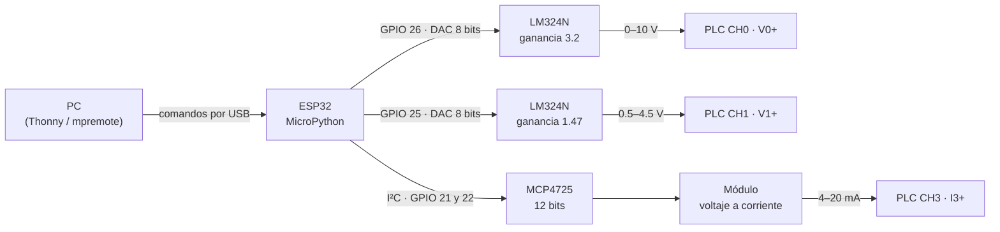

# Simulador de señales industriales para PLC

Reto con **Daikin Applied** (Bloque Automatización Industrial, Tec de Monterrey, campus San Luis Potosí).

Un generador de señales industriales controlado por software: un ESP32 produce **0–10 V**, **0.5–4.5 V** y **4–20 mA**, y un PLC Delta DVP20SX2 las lee y las convierte en variables de proceso. Es el primer paso hacia un simulador de entradas y salidas que permita probar controladores de chiller **sin un chiller real**.

> **Estado:** prototipo en protoboard funcionando de punta a punta, según el equipo. Experimento de precisión en curso. Faltan NTC, PCB y aislamiento. Detalle en [Estado y roadmap](#estado-y-roadmap).

---

## Por qué existe

Hoy las pruebas del software de los controladores se hacen en gabinetes reales del laboratorio, y fuera de él las validaciones son limitadas. Un controlador sin sensores conectados muestra lecturas absurdas (por ejemplo, presiones de miles de PSI negativos). El simulador entrega al controlador las mismas señales eléctricas que daría un chiller, para repetir escenarios completos, incluidas fallas, desde una computadora.

## Qué hace

| Canal | Señal | Representa | Entrada del PLC | Lectura del PLC |
|---|---|---|---|---|
| A | 0–10 V | Variable de proceso en voltaje | CH0 (V0+) | 0–2000 cuentas → `TEMPERATURA` 25–650 |
| B | 0.5–4.5 V | Transductor de presión ratiométrico | CH1 (V1+) | 100–900 cuentas → `PRESION` 0–100 |
| C | 4–20 mA | Transmisor industrial de corriente | CH3 (I3+) | 0–2000 cuentas → `NIVEL` 0–100 |
| — | NTC 10 kΩ | Temperaturas | — | **Pendiente** (resistencia no lineal) |

## Arquitectura



Cada señal sigue la misma cadena: un DAC fija un voltaje de control, una etapa de acondicionamiento lo convierte en la señal industrial y el PLC la lee en una entrada analógica.

---

## Hardware

### Lista de materiales (prototipo actual)

| Pieza | Detalle |
|---|---|
| ESP32 clásico (WROOM) | Necesita los DAC internos de los GPIO 25 y 26 |
| LM324N | Un solo chip: sección 1 para el canal A y sección 2 para el B |
| MCP4725 | DAC de 12 bits por I²C, dirección 0x60 |
| Módulo voltaje a corriente | Entrada IN+ / IN−, salida VCC / OUT / GND, calibrado con dos trimpots |
| Resistencias | 2.2 kΩ, 1 kΩ, 4.7 kΩ y 10 kΩ |
| Fuente | 12 V para el LM324 y el módulo |
| PLC | Delta DVP20SX2 (4 entradas analógicas, 12 bits) |

### Conexiones

| Bloque | Conexión |
|---|---|
| Alimentación del LM324 | Pin 4 a +12 V, pin 11 a GND |
| Secciones sin usar | Pin 10 a GND y pin 9 unido al pin 8; pin 12 a GND y pin 13 unido al pin 14 |
| **Canal A** | GPIO 26 → pin 3. 2.2 kΩ del pin 1 al pin 2; 1 kΩ del pin 2 a GND. Salida: pin 1 |
| **Canal B** | GPIO 25 → pin 5. 4.7 kΩ del pin 7 al pin 6; 10 kΩ del pin 6 a GND. Salida: pin 7 |
| **Canal C** | MCP4725: VCC a 3V3, GND a GND, SDA a GPIO 21, SCL a GPIO 22. OUT → IN+ del módulo; IN− a GND. VCC del módulo a +12 V, GND a GND. OUT del módulo → entrada de corriente del PLC |

**Tierra común:** el GND del ESP32, del MCP4725, del módulo y de la fuente van al mismo punto. Sin eso las lecturas salen sin sentido.

Cómo funciona cada canal de voltaje: el ampop no inversor multiplica el voltaje del DAC por `G = 1 + RF/RG` (3.2 en A, 1.47 en B), y el código calcula esa cuenta al revés: se pide la salida deseada y obtiene el voltaje de entrada.

---

## Software del ESP32

**Requisitos:** MicroPython v1.29.0 (build `ESP32_GENERIC`) y Thonny (o `mpremote`).

Programas en [`firmware/esp32/`](firmware/esp32):

| Archivo | Para qué sirve |
|---|---|
| `senales_todo.py` | Las tres señales juntas, con comandos |
| `calibrar_modulo.py` | Calibración del módulo de 4–20 mA con el MCP4725 |
| `senal_voltaje_dac.py` | Ejercicios 1 y 2 (un canal a la vez) |
| `diag_dac.py` | Revisa los DAC internos |
| `diag_i2c.py`, `diag_i2c_tiempos.py` | Diagnóstico del MCP4725 por I²C |

### Uso

Corre `senales_todo.py` y escribe en la terminal:

```
a 5        # canal A: 5 V
b 2.5      # canal B: 2.5 V
c 12       # canal C: 12 mA
tabla      # recorre los puntos de los tres canales
apagar     # todo en 0
salir      # sale y reinicia el ESP32
```

**Sal siempre con `salir`**, no con el botón de Stop: el programa libera los DAC y reinicia la placa. Si no, la siguiente corrida puede fallar con `ESP_ERR_INVALID_STATE`.

### Calibración

- **Canales A y B:** constantes `CAL_GANANCIA` y `CAL_OFFSET` al inicio del programa, ajustadas con un multímetro.
- **Canal C:** con `calibrar_modulo.py`. Escribe `4` y gira el trimpot del límite **inferior** hasta ver 4.00 mA; escribe `20` y gira el del límite **superior** hasta 20.00 mA. Repite 2 o 3 veces, porque se afectan entre sí. Con IN+ en 0 V da 4 mA y con 3.0 V da 20 mA (`V_4MA` y `V_20MA`).

---

## PLC (Delta DVP20SX2, ISPSoft 3.22)

Programas en [`plc/`](plc): `IO_Analogicas.isp` (original de la materia, 7 redes) e `IO_Analogicas_v2.isp` (ampliado a 11 redes).

### Cableado

| Señal | Terminales del PLC |
|---|---|
| Canal A | Señal a **V0+**, referencia **VI0−** a GND |
| Canal B | Señal a **V1+**, referencia **VI1−** a GND |
| Canal C | OUT del módulo a **I3+**, con **V3+ puenteado a I3+**; **VI3−** a GND |

En el canal C **no va resistencia de 250 Ω**: el PLC ya trae la suya en la entrada de corriente. La corriente debe entrar por I3+ y salir por VI3−.

### Programa

- `D1114` habilita los canales y `D1115 = K2056` deja el **canal 3 en 4–20 mA** y los demás en voltaje.
- Con voltaje, ±10 V equivalen a ±2000 cuentas (1 cuenta = 5 mV). En el modo 4–20 mA, el rango es de 0 a 2000 cuentas.
- Las redes 8 a 11 leen `D1111` y `D1113` y las escalan con `SCLP`.
- **Variables:** `AD_CH0` D7001, `TEMPERATURA` D7002, `VELOCIDAD` D7003, `AD_CH1` D7004, `PRESION` D7005, `AD_CH3` D7006 y `NIVEL` D7007.
- **Arranque:** `arranque` (M0), `paro` (M1) y `aux` (M2) son bits de memoria. Pon M0 en ON desde el monitor de ISPSoft para que `aux` se enclave; sin `aux` los canales están deshabilitados.

### Valores esperados

| Canal | Mandas | Cuentas | Valor escalado |
|---|---|---|---|
| A | 0 / 5 / 10 V | 0 / 1000 / 2000 | `TEMPERATURA` 25 / ≈338 / 650 |
| B | 0.5 / 2.5 / 4.5 V | 100 / 500 / 900 | `PRESION` 0 / 50 / 100 |
| C | 4 / 12 / 20 mA | 0 / 1000 / 2000 | `NIVEL` 0 / 50 / 100 |

Se espera una diferencia de hasta 1 % del fondo de escala, que es la precisión que indica la hoja del PLC.

---

## Experimento de precisión

Compara, durante una hora, el valor **pedido**, el **teórico** (con el redondeo del DAC de 8 bits) y lo que **lee el PLC**, para decidir con datos si vale la pena cambiar a un DAC de 12 o 16 bits.

Código en [`experimento_precision/`](experimento_precision). Instrucciones completas en su `LEEME.txt`.

```bash
pip install pyserial matplotlib numpy mpremote

# solo probar la lectura del PLC
python registrar.py --plc COM5 --probar-plc

# corrida corta de prueba, y luego la hora completa
python registrar.py --esp COM3 --plc COM5 --minutos 10 --periodo 10
python registrar.py --esp COM3 --plc COM5
```

Genera gráficas (pedido contra PLC, error en el tiempo, histogramas, deriva y mejora estimada con 12 y 16 bits) y un `resumen.txt` con la conclusión.

> **Aviso:** la lógica del ciclo, el registro por Modbus y el análisis se probaron con un ESP32 y un PLC **simulados**. Falta confirmar la corrida con el hardware real.

---

## Decisiones de diseño

| Decisión | Alternativa descartada | Argumento |
|---|---|---|
| Voltaje con los DAC del ESP32 | PWM con filtro RC | Sin capacitor, el PWM es una onda cuadrada; el DAC da voltaje continuo |
| Ampop no inversor, 12 V | Sumador inversor, 5 V | El inversor se satura con una sola fuente; con 5 V el LM324 no llega a 4.5 V |
| Ganancia 1.47 en B | 1.2 o 1.36 | Deja ~7 % de margen en el DAC; 1.36 llega justo a 4.5 V |
| MCP4725 para el canal C | DAC interno de 8 bits | Los dos DAC internos ya los usan A y B; paso de ~0.004 mA |
| Módulo comercial de 4–20 mA | Etapa discreta con transistor | Integra ampop y transistor y se calibra con dos trimpots |
| Rango 0.5–4.5 V | 0–5 V | Los extremos se reservan para detectar cable roto o corto |

---

## Problemas conocidos

| Síntoma | Causa probable | Solución |
|---|---|---|
| `ESP_ERR_INVALID_STATE` al crear un DAC | El DAC quedó ocupado de una corrida anterior | Desconectar el USB, o `machine.reset()`; salir siempre con `salir` |
| `ENODEV` al escribir al MCP4725 | Escritura I²C sin lectura previa, o contacto flojo | Usar la versión actual de `senales_todo.py` (bus nuevo por escritura) |
| Salidas que no cuadran con las cuentas | Tierra común mal unida, o falsos contactos de la protoboard | Unir todas las tierras a un punto; cambiar de protoboard |
| Canal A en 10 V justo | El LM324 llega a ~10.5 V con 12 V | Alimentar con 15 V o usar un ampop rail-to-rail |
| CH3 siempre en 0 | Falta el puente V3+/I3+, o corriente al revés | Revisar puente y polaridad; confirmar `D1115` |

---

## Estado y roadmap

- [x] Canales A, B y C generados y calibrados
- [x] PLC leyendo las tres señales con escalamiento
- [x] Resumen ejecutivo del proyecto
- [ ] Experimento de precisión con hardware real
- [ ] Decidir el DAC externo multicanal (12 o 16 bits) según los datos
- [ ] NTC: emulación de resistencia con la curva del sensor
- [ ] Esquemático y PCB (una capa, agujero pasante, fresada en la CNC del campus)
- [ ] Alimentación a 24 V (la parte de línea, con fuente certificada)
- [ ] Biblioteca de sensores e inyección de fallas
- [ ] Control automático desde la PC
- [ ] Interfaz web y pantalla táctil
- [ ] Caja impresa en 3D

---

## Estructura del repositorio

```
.
├── README.md
├── firmware/
│   └── esp32/              # programas de MicroPython
├── plc/                    # proyectos de ISPSoft (.isp)
├── experimento_precision/  # registro, análisis y gráficas
│   └── ejemplo_SIMULADO/   # gráficas de ejemplo con datos inventados
├── hardware/               # esquemáticos y PCB (pendiente)
└── docs/                   # resumen ejecutivo y notas
```

## Cómo contribuir

1. No trabajes directo en `main`. Crea una rama por tarea: `feature/ntc`, `fix/i2c-mcp4725`.
2. Haz commits pequeños con mensajes claros, por ejemplo `fix: reintenta lectura I2C antes de escribir`.
3. Abre un Pull Request y pide revisión a alguien del equipo antes de unir.
4. **Si cambias el cableado o una constante de calibración, actualiza este README.**

## Reglas del repositorio

- **No subas material confidencial de Daikin** (presentaciones, hojas de datos con restricciones, planos). Confirma con los profesores qué se puede publicar.
- **No subas contraseñas, tokens ni datos personales.**
- Los datos crudos de las corridas largas (`datos_*/`) no se suben; solo los resúmenes y las gráficas que se usen en reportes.

## Equipo

<!-- TODO: nombres, roles y contacto -->

Proyecto del Bloque de Automatización Industrial, Tec de Monterrey, campus San Luis Potosí. Agradecimientos a los profesores del bloque y a Daikin Applied como socio formador.

## Licencia

Por definir con los profesores y con Daikin antes de publicar el repositorio.
